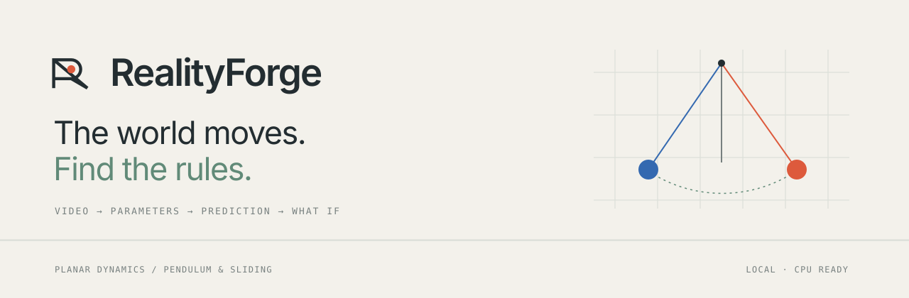
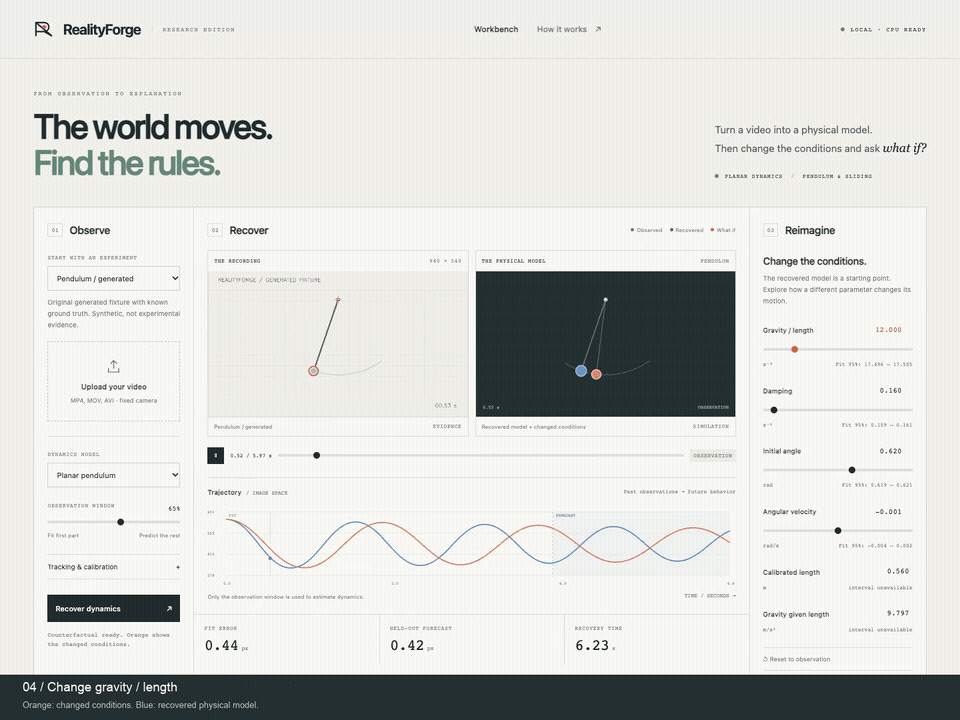
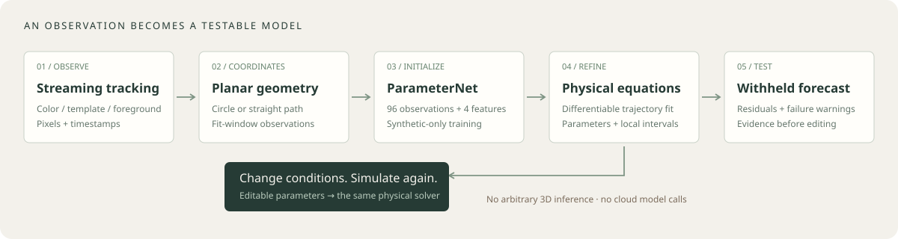

<p align="center"></p>

<p align="center">
  <a href="https://github.com/nazeeh111/RealityForge/actions/workflows/test.yml"></a>
  
  
  <a href="LICENSE"></a>
</p>

**Turn a video into a physical model. Then change the conditions and ask what if.**

RealityForge is a local application for identifying **planar pendulum and straight-line sliding dynamics** from ordinary experiment videos. Track a moving object, recover observable parameters with a compact PyTorch estimator and differentiable physics, inspect a held-out forecast, and change the parameters in an interactive workbench.

It is an original implementation with trained weights, real recording checks, analytical comparisons and reproducible experiments. Its scientific scope is deliberately explicit: fixed camera, one tracked object, two supported dynamics families. It does not reconstruct general 3D scenes or discover arbitrary physical laws.

<p align="center"></p>

[Watch the short app demo](docs/assets/realityforge-demo.mp4) · [Method](docs/method.md) · [Benchmarks](docs/evaluation.md) · [Model card](docs/model-card.md) · [Reproduce](docs/reproducibility.md)

The recorded tour shows the earlier interface running an original **generated fixture**, visibly labeled synthetic. Real IRIS and independent recording results are reported separately below. No inference response is mocked.

## Run locally

Python 3.11–3.14, a modern browser, and a CPU are sufficient. No account, API key or cloud inference service is needed. Python 3.12 is the tested reference environment.

```bash
git clone https://github.com/nazeeh111/RealityForge.git
cd RealityForge
python3.12 -m venv .venv
source .venv/bin/activate
python -m pip install --upgrade pip
python -m pip install -e '.[dev]'
realityforge serve
```

Open **[localhost:8000](http://127.0.0.1:8000)**. The trained models and small sample clips are included. Windows: activate with `.venv\Scripts\activate`.

1. Choose a generated example or real recording, or upload your own video.
2. Under **Tracking & calibration**, draw a box around the object in the first frame. Add a visible pivot or a known meters-per-pixel scale when available.
3. Recover dynamics. The initial observation window fits the model; the rest of the recording tests the forecast.
4. Play the synchronized comparison, inspect the residuals and assumptions, and change a physical parameter. Export the analysis or a comparison image.

Uploads and analysis stay on the local server. Results are written to `.realityforge/` in the directory from which the app is launched. Set `REALITYFORGE_OUTPUT_DIR` to choose another location. Uploaded files are retained there until you remove them. The server binds only to `127.0.0.1`; it is a local research application, not a hardened public upload service.

For your own footage, use a stationary, upright camera facing the motion plane. Include the entire moving object, avoid occlusion, and trim away hand contact, impacts and changes in playback speed. H.264 MP4 gives the most reliable browser playback. Server decoding also supports formats OpenCV can read. The upload limit is 100 MB; analysis uses at most 60 seconds and 1,800 frames, with tracking at no more than 30 fps and a maximum image dimension of 1,280 pixels.

## What the model can identify

| System | Recovered quantities | What requires additional evidence |
|---|---|---|
| Pendulum | Restoring coefficient `k = g/L`, angular damping, initial angle and angular velocity | Gravity and length cannot be separated from timing alone. Supplying a scale gives image-plane length and gravity conditional on planar geometry. |
| Sliding | Signed acceleration, initial velocity and position along the image-plane path | Metric acceleration requires a scale reference in that plane. Mass, friction and applied force cannot be separated from these tracks alone. |

Uniform scale calibration is supported. General perspective correction, lens calibration, moving cameras, collisions, deformables and arbitrary 3D reconstruction are outside this release. Sliding uses constant acceleration and has no contact or stopping law, so an edited trajectory can pass through a physical stop.

Automatic selection screens the two supported families using fit-window geometry and significant motion reversals. It is a useful starting point, not an open-world equation classifier. A short, nearly straight pendulum arc can remain ambiguous. You can select the family explicitly.

Nominal 95% intervals are **uncalibrated local sensitivity estimates**, conditional on the fitted geometry, tracking and chosen equation. They exclude camera, scale, tracking bias and model error. They should not be interpreted as guaranteed 95% coverage.

## How it works

<picture>
  <source media="(max-width: 600px)" srcset="docs/assets/architecture-portrait.svg">
  
</picture>

[Follow the default hybrid workflow in the source](docs/architecture.md).

- **Inspect motion:** bounded-memory video decoding; adaptive color centroids with a first-frame region, template matching when color is unavailable, or fit-window foreground tracking.
- **Choose observable coordinates:** fit a circular arc or straight path using only the observation window. Preserve pixels and timestamp units.
- **Initialize parameters:** two small MLPs, about 16,000 weights each, trained only on seeded synthetic trajectories. Inputs combine 96 resampled observations and four numerical summary features.
- **Refine with physics:** PyTorch differentiates a nonlinear pendulum integrator or constant-acceleration model. Robust trajectory fitting optimizes the parameters and initial state.
- **Test and interact:** evaluate the withheld portion, expose residuals and local uncertainty, and rerun the same equations under edited parameters.

The implemented ML contribution is a compact learned initializer coupled to differentiable shooting. **The current evidence does not show an advantage over analytical initialization plus the same refinement.** This comparison is part of the release, not hidden by the interface.

## Measured evidence

<!-- BENCHMARKS_START -->
| Synthetic family | Cases | Median forecast | Median primary parameter error |
|---|---:|---:|---:|
| Pendulum | 24 | 0.232 px | 0.032% |
| Sliding | 24 | 0.356 px | 0.438% |

These are trajectory-level synthetic results, with noise and outliers. They do not measure real-video accuracy.

| Real development recording | Held-out forecast |
|---|---:|
| pendulum20 | 9.43 px |
| pendulum45 | 10.38 px |
| pendulum90 | 21.54 px |
| sliding45 | 12.48 px |
| rhetos-pendulum | 1.17 px |

A separately frozen six-recording IRIS check completed **6/6** attempts, with median forecast **12.59 px**. [Every attempt and protocol](benchmarks/blind-iris.json).


<!-- BENCHMARKS_END -->

Real recording errors measure predicted position against automatically extracted tracks, not independent manual point annotations. These five recordings were excluded from neural training but informed tracker development. They are a small transfer check, not the complete official IRIS protocol or a blind benchmark. Pendulum metadata contains nominal rope length, which need not equal effective pivot-to-bob-center length; sliding friction/acceleration truth is unavailable.

We compare neural initialization, analytical estimation, analytical plus physics refinement, hybrid inference and constant velocity. The published IRIS pendulum recurrence is also evaluated with an observed-angle adapter, clearly separated from the full learned IRIS encoder. Matched published end-to-end baseline scores are not claimed. [Exact protocols, failures and limits →](docs/evaluation.md)

## Reproduce and extend

```bash
# Independent physical, tracking, model and API checks
python -m pytest -q

# Train both compact estimators from scratch; export portable models
python scripts/train.py --count 6000 --epochs 100 --seed 47 \
  --output local-results/retrained-models

# Recreate the original generated videos; requires FFmpeg on PATH
python scripts/generate_samples.py

# Independent synthetic trajectories; fit 65%, forecast 35%
python scripts/evaluate_synthetic.py --seed 2026 --cases 24

# The bundled real recording subset
python scripts/evaluate_real.py
python scripts/evaluate_blind_iris.py
python scripts/evaluate_selection.py
python scripts/report_benchmarks.py

# One video from the command line
realityforge analyze samples/generated/pendulum.mp4 \
  --settings '{"mode":"pendulum","roi":[620,310,46,46],"pivot":[480,105]}' \
  --output analysis.json
```

FFmpeg is needed only to regenerate/transcode videos, not to run inference on the included samples. [Reproducibility](docs/reproducibility.md) explains dependency snapshots, exported model checks and data reacquisition. Runtime and encoded video bytes vary across hardware and dependency versions.

```text
realityforge/        Tracking, geometry, inference, equations, baselines and local API
web/                Build-free interactive workbench
models/             Trained checkpoints, exports and training metadata
samples/            Generated fixtures and separately licensed real recordings
scripts/            Training, evaluation, acquisition and presentation generation
benchmarks/         Per-case measurements and reproducible analysis artifacts
tests/              Independent solver, gradient, tracking, model and API checks
docs/               Method, model card, evaluation, reproducibility and research audit
```

## Research record

The [research record](docs/research.md) links the source studies, inspected revisions and concrete design decisions.

## License and contribution

Original code, trained weights and generated fixtures: **[MIT](LICENSE)**. Real media has separate terms:

- IRIS clips and metadata: **CC BY-NC 4.0**, with attribution. These assets are not licensed for unrestricted commercial use.
- Independent Rhetos recording: **CC BY-SA 4.0**, with attribution and share-alike requirements for adaptations.

Read [NOTICE.md](NOTICE.md) and the notices beside each recording before redistributing media. For a code-only MIT distribution, exclude the third-party media/metadata and remove their sample-manifest entries. The main demo uses only original generated footage.

[Contributing](CONTRIBUTING.md) · [Security](SECURITY.md) · [Citation](CITATION.cff)
