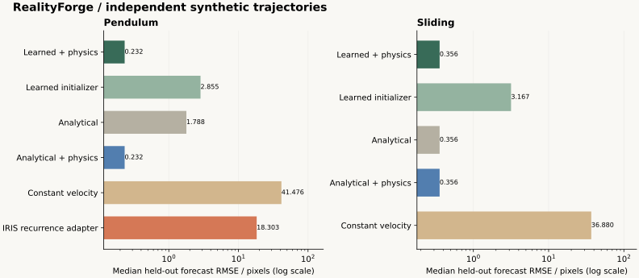

# Measured benchmark results

Generated from the checked-in JSON reports by `python scripts/report_benchmarks.py`. Every reported failure remains in the source report. A completed/succeeded fit means a finite result was returned, not that an accuracy threshold was passed. Runtime is a single-run CPU measurement affected by host load, not a controlled speed ranking.

## Independent synthetic trajectories

24 trajectories per family; seed 2026, fit 65%, forecast 35%. Clean positions come from an independent SciPy solver for pendulums and the exact sliding polynomial. Noise levels 0, 0.5 and 2 pixels; the last case per family includes 5% outliers. This layer excludes video tracking.

| Family | Method | Succeeded / attempted | Median forecast px | Median primary parameter error | Median inference s | Nominal interval coverage |
|---|---|---:|---:|---:|---:|---:|
| pendulum | Learned + physics | 24 / 24 | 0.232 | 0.032% | 1.560 | 62.5% |
| pendulum | Learned initializer | 24 / 24 | 2.855 | 0.801% | 0.011 | — |
| pendulum | Analytical | 24 / 24 | 1.788 | 0.854% | 0.010 | — |
| pendulum | Analytical + physics | 24 / 24 | 0.232 | 0.032% | 1.171 | 62.5% |
| pendulum | Constant velocity | 24 / 24 | 41.476 | — | 0.000 | — |
| pendulum | IRIS recurrence adapter | 24 / 24 | 18.303 | 1.158% | 0.003 | — |
| sliding | Learned + physics | 24 / 24 | 0.356 | 0.438% | 0.022 | 70.8% |
| sliding | Learned initializer | 24 / 24 | 3.167 | 1.925% | 0.012 | — |
| sliding | Analytical | 24 / 24 | 0.356 | 0.367% | 0.009 | — |
| sliding | Analytical + physics | 24 / 24 | 0.356 | 0.438% | 0.011 | 75.0% |
| sliding | Constant velocity | 24 / 24 | 36.880 | — | 0.000 | — |

The primary parameter is pendulum `k=g/L` or signed sliding acceleration. Nominal 95% intervals are uncalibrated local approximations; measured coverage is displayed above rather than assumed. Analytical initialization plus the same physical refinement is an essential ablation.

## Development recording transfer check

These five clips were excluded from neural training but informed tracker development. Errors are against extracted tracks, not independent point annotations. Families are selected explicitly; the separate selection report evaluates automatic screening.

| Recording | Learned + physics px | Analytical + physics px | IRIS recurrence adapter px | Learned only px | Constant velocity px |
|---|---:|---:|---:|---:|---:|
| pendulum20 | 9.433 | 9.433 | 45.126 | 101.622 | 123.250 |
| pendulum45 | 10.377 | 10.377 | 63.288 | 50.388 | 212.195 |
| pendulum90 | 21.542 | 21.543 | 32.579 | 130.190 | 313.400 |
| sliding45 | 12.484 | 12.484 | — | 14.142 | 76.610 |
| rhetos-pendulum | 1.167 | 1.167 | 18.722 | 41.760 | 123.252 |

IRIS recurrence is a reimplementation of the published discrete physical component using shared observed angles. It bypasses the learned video encoder and latent objective. These numbers are not reported complete IRIS/EndPhys pipeline scores.

| Recording | Effective length m, assuming g=9.80665 | Difference to nominal rope length | Tracking s | Inference s | Total s |
|---|---:|---:|---:|---:|---:|
| pendulum20 | 0.5212 | 4.23% | 1.552 | 5.741 | 7.292 |
| pendulum45 | 0.5266 | 5.31% | 3.501 | 5.686 | 9.188 |
| pendulum90 | 0.5427 | 8.54% | 2.651 | 4.506 | 7.157 |
| sliding45 | — | — | 0.603 | 0.032 | 0.635 |
| rhetos-pendulum | 0.4989 | — | 11.111 | 6.084 | 17.195 |

Length differences are consistency checks, not precision parameter errors. The nominal rope may exclude bob radius. Independent household length is approximate and author-reported; sliding acceleration/friction truth is unavailable.

## Frozen unseen IRIS recordings

Six recording IDs and clip windows were preselected, and core/model hashes frozen before acquisition. A fixed first-frame green-component rule initializes the region. No future-frame tuning or selection is allowed. All attempts, including failures, are retained. This is an unseen-recording transfer check within the supported IRIS pendulum setup, not the complete benchmark.

| Method | Succeeded / attempted | Median forecast px | Worst forecast px | Median inference s |
|---|---:|---:|---:|---:|
| Learned + physics | 6 / 6 | 12.589 | 23.363 | 3.094 |
| Analytical + physics | 6 / 6 | 12.589 | 23.362 | 4.190 |
| IRIS recurrence adapter | 6 / 6 | 54.008 | 120.011 | 0.010 |

See [all frozen attempts](../benchmarks/blind-iris.json) and [first-frame regions/provenance](../samples/blind-provenance.json).

## Supported-family selection

The geometry/reversal screen selected the expected family in **13 / 13** listed cases. This small diagnostic includes small-angle pendulums, straight tracks and the development recordings. It does not establish arbitrary equation recognition. Short monotonic pendulum arcs remain ambiguous. [Per-case evidence](../benchmarks/model-selection.json).

## Read the limitations with the measurements

See [evaluation](evaluation.md), [model card](model-card.md) and [research audit](research.md). Full latent-video baseline reproduction, calibrated uncertainty, general camera calibration and 3D reconstruction are not claimed.
